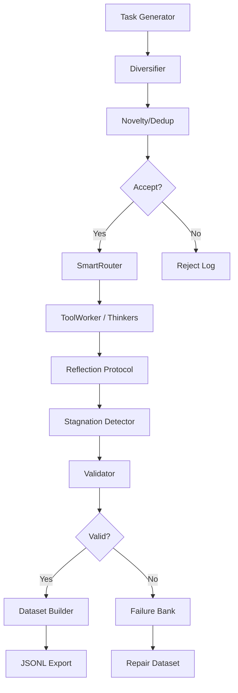

# Autonomous Synthetic Data Generator — Design Document

**Date:** 2026-10-07  
**Status:** DESIGN (Phase 0)  
**Project:** Life_mean — Multi-agent reasoning system

---

## 1. Motivation

The original question was:

> Why don't people simply write their own Python programs to generate interesting training data?

This project already contains a large reasoning architecture:

```
Task → Router → Workers / Tools / Thinkers → Reflection / Debate → Judge / Validation → Result → RAW storage
```

The proposed extension transforms this into a **factory** that generates its own problems, solves them, verifies them, and converts reliable executions into datasets.

**Key principle:** Generation and training MUST remain separated. The system must first be capable of generating and inspecting datasets without modifying the model.

---

## 2. Current Architecture Discovered

### 2.1 Core Components (EXISTING)

| Component | Location | Status | Description |
|-----------|----------|--------|-------------|
| EventBus | `core/events/event_bus.py` | ✅ COMPLETE | Decoupled pub/sub communication |
| Message | `core/events/message.py` | ✅ COMPLETE | Universal communication unit, Task dataclass |
| SmartRouter | `core/assignment/router.py` | ✅ COMPLETE | Deterministic worker routing with scoring |
| Worker | `core/runtime/worker.py` | ✅ COMPLETE | BaseWorker, DeterministicWorker |
| ToolWorker | `core/workers/tool.py` | ✅ COMPLETE | Executes 59 deterministic tools |
| Tool Detection | `library/tools/detection.py` | ✅ COMPLETE | Keyword→tool mapping |

### 2.2 Library Components (EXISTING)

| Component | Location | Status | Description |
|-----------|----------|--------|-------------|
| Tools | `library/tools/{math,chemistry,physics,coding,logic}/` | ✅ COMPLETE | 59 deterministic tools |
| Personas | `library/personas/` | ✅ COMPLETE | CorpusThinker base + philosophy/science/data registries |
| Protocols | `library/protocols/` | ✅ COMPLETE | ReflectionProtocol, StagnationDetector |
| Reliability | `library/reliability/` | ✅ COMPLETE | AdaptiveContextManager, FallbackRecovery |

### 2.3 Empty Directories (NEED IMPLEMENTATION)

| Directory | Purpose |
|-----------|---------|
| `experiments/` | Experiment infrastructure |
| `autopilot/` | Curriculum controller |
| `benchmarks/` | Held-out evaluation |
| `analysis/` | Weakness analysis |
| `core/validation/` | Validation primitives |
| `core/recovery/` | Recovery orchestration |

### 2.4 Missing Components

- **Task Generator** — Creates candidate problems
- **Diversifier** — Mutates/varies tasks
- **Novelty/Deduplication** — Avoids superficial variations
- **Validator** — External/deterministic verification
- **Failure Bank** — Stores failed executions
- **Dataset Builder** — Exports to JSONL/other formats
- **Experiment Config** — Records exact configurations
- **UI Controls** — Experiment interface

---

## 3. Existing Reusable Components

### 3.1 SmartRouter (Reuse)

```python
# Already exists in core/assignment/router.py
router = SmartRouter()
result = router.route("Calculate GCD of 12 and 8", top_k=1)
# Returns: {"selected": ["tool_worker"], "scores": {...}, "difficulty": 1, ...}
```

**Reuse for:** Routing generated tasks through existing worker pipeline.

### 3.2 ToolWorker (Reuse)

```python
# Already exists in core/workers/tool.py
worker = ToolWorker(bus)
message = Message(type="task", payload={"description": "Calculate GCD of 12 and 8"})
worker.execute(message)
# Auto-detects tool: math_gcd, executes deterministically
```

**Reuse for:** Executing generated tasks through deterministic tools.

### 3.3 Personas (Reuse)

```python
# Already exists in library/personas/
from library.personas import get_persona
thinker = get_persona("philosophy", "aristotle")
synthesis = thinker.synthesize(topic="ethics")
```

**Reuse for:** Generating tasks with persona-based constraints, or using personas as judges.

### 3.4 Reflection Protocol (Reuse)

```python
# Already exists in library/protocols/reflection.py
from library.protocols import reflect_hypothesis
result = reflect_hypothesis("The answer is 42", assumption="Answer must be positive")
```

**Reuse for:** Validating generated solutions through mirror transformations.

### 3.5 Stagnation Detector (Reuse)

```python
# Already exists in library/protocols/stagnation.py
from library.protocols import StagnationDetector
detector = StagnationDetector()
detector.add_turn("What is X?", "X is 5")
status = detector.status()
```

**Reuse for:** Detecting when generated tasks are too similar (stagnation).

### 3.6 AdaptiveContextManager (Reuse)

```python
# Already exists in library/reliability/context.py
from library.reliability import compute_signals, plan_budget
signals = compute_signals(user_query="Complex task")
plan = plan_budget(signals)
```

**Reuse for:** Budgeting context for generated tasks.

---

## 4. Deterministic Mode Investigation

### 4.1 Current State

**PARTIALLY IMPLEMENTED** — The system has deterministic tools but NO explicit mode switching.

**What exists:**
- `ToolWorker` executes deterministic tools via `_execute_tool()`
- `DeterministicWorker` base class exists in `core/runtime/worker.py`
- Tool detection maps keywords to tool names

**What's missing:**
- No experiment configuration system
- No UI toggle for deterministic mode
- No way to compare MODE A (deterministic) vs MODE B (LLM) vs MODE C (hybrid)

### 4.2 Proposed Configuration Pattern

```python
# Reuse existing patterns or create new ExperimentConfig
@dataclass
class ExperimentConfig:
    deterministic: bool = True      # Use deterministic tools only
    llm_reasoning: bool = False     # Allow LLM reasoning
    tools: bool = True              # Enable tool execution
    thinkers: bool = False          # Enable persona thinkers
    reflection: bool = False        # Enable reflection protocol
    debate: bool = False            # Enable debate
    diversification: bool = False   # Enable task diversification
    
    # Reproducibility
    seed: int = 42
    generator_version: str = "1.0.0"
    
    # Experiment tracking
    experiment_id: str = ""
    run_id: str = ""
```

### 4.3 UI Integration Points

**Current UI:** None exists in the Python project (hermes-orchestrator is a separate Node.js project).

**Proposed integration:**
- Add experiment controls to hermes-orchestrator UI
- Or create a separate experiment dashboard
- Store configuration in `experiments/configs/`

---

## 5. Proposed Architecture

### 5.1 High-Level Flow



### 5.2 Component Responsibilities

| Component | Responsibility | Location |
|-----------|---------------|----------|
| TaskGenerator | Create candidate problems | `experiments/generation/task_generator.py` |
| Diversifier | Mutate/variate tasks | `experiments/generation/diversifier.py` |
| NoveltyDetector | Deduplication, similarity | `experiments/generation/novelty.py` |
| DatasetBuilder | Export to formats | `experiments/generation/dataset_builder.py` |
| ExperimentConfig | Track configurations | `experiments/config.py` |
| FailureBank | Store failures | `experiments/failure_bank.py` |
| WeaknessAnalyzer | Analyze benchmark results | `analysis/weakness_analyzer.py` |
| CurriculumController | Adaptive generation | `autopilot/curriculum.py` |

---

## 6. Task Generator Design

### 6.1 API (Proposed)

```python
from experiments.generation.task_generator import TaskGenerator

generator = TaskGenerator()

# Generate a task
task = generator.generate(
    domain="math",           # math, physics, chemistry, coding, logic
    difficulty=3,            # 1-5
    reasoning_type="debugging",  # calculation, debugging, analysis, etc.
    constraints=["no_libraries"],
    num_steps=3,             # Expected steps to solve
)

# Generate with persona
task = generator.generate(
    domain="philosophy",
    thinker="aristotle",     # Use specific persona
    topic="ethics",
)
```

### 6.2 Task Schema (Proposed)

```python
@dataclass
class GeneratedTask:
    task_id: str                    # UUID
    source: str                     # "generator" or "benchmark"
    domain: str                     # math, physics, etc.
    difficulty: int                 # 1-5
    reasoning_type: str             # calculation, debugging, analysis
    description: str                # Natural language task
    constraints: List[str]          # Additional constraints
    expected_steps: int             # Expected solution steps
    required_tools: List[str]       # Tools needed
    ground_truth: Any               # Verified answer
    metadata: Dict[str, Any]        # Generator config, seed, version
    
    # Provenance
    generator_version: str = "1.0.0"
    seed: int = 42
    created_at: float = field(default_factory=time.time)
```

### 6.3 Generation Strategies

| Strategy | Description | Implementation |
|----------|-------------|----------------|
| Template-based | Fill templates with random values | ✅ PROPOSED |
| Mutation | Modify existing tasks | ✅ PROPOSED |
| Cross-domain | Combine domains | ⏳ FUTURE |
| Adversarial | Create edge cases | ⏳ FUTURE |
| Persona-driven | Use persona constraints | ⏳ FUTURE |

---

## 7. Diversification Strategy

### 7.1 Mutation Types (Proposed)

```python
class Diversifier:
    """Mutate tasks to create variations."""
    
    def mutate_paraphrase(self, task: str) -> str:
        """Rephrase without changing meaning."""
        # Use deterministic word substitution
        
    def mutate_constraints(self, task: str, constraints: List[str]) -> Tuple[str, List[str]]:
        """Add/remove/modify constraints."""
        # e.g., add "without using loops"
        
    def mutate_difficulty(self, task: str, difficulty: int) -> Tuple[str, int]:
        """Increase/decrease difficulty."""
        # e.g., change numbers, add steps
        
    def mutate_domain(self, task: str, source_domain: str, target_domain: str) -> str:
        """Translate task to different domain."""
        # e.g., math → physics application
```

### 7.2 Reuse Existing Mechanisms

**SmartRouter Opposition Mode:**
```python
# Already exists in core/assignment/router.py
result = router.route(description, opposition_mode=True)
# Returns workers from opposite domain for diversity
```

**Use for:** Ensuring generated tasks exercise different worker combinations.

---

## 8. Novelty/Deduplication Strategy

### 8.1 Similarity Detection (Proposed)

```python
class NoveltyDetector:
    """Estimate whether a task is meaningfully different."""
    
    def compute_signature(self, task: str) -> str:
        """Create structural signature for deduplication."""
        # Normalize, extract keywords, create hash
        
    def is_duplicate(self, new_task: str, existing_tasks: List[str], threshold: float = 0.8) -> bool:
        """Check if task is too similar to existing ones."""
        # Use normalized text hashing + lexical similarity
        
    def novelty_score(self, task: str, corpus: List[str]) -> float:
        """Return novelty score [0.0, 1.0]."""
        # Higher = more novel
```

### 8.2 Simple Implementation (V1)

- Normalized text hashing (remove whitespace, lowercase, hash)
- Lexical similarity (Jaccard similarity on word sets)
- Structural signature (extract problem type + constraints)

**No embeddings required for V1.**

---

## 9. Validation Strategy

### 9.1 Deterministic Verification (Preferred)

```python
class Validator:
    """External/deterministic verification."""
    
    def validate_math(self, task: str, answer: Any, ground_truth: Any) -> Dict[str, Any]:
        """Validate math answers with deterministic check."""
        # Use existing math tools for verification
        
    def validate_code(self, task: str, code: str, tests: List[str]) -> Dict[str, Any]:
        """Execute code and run unit tests."""
        # Isolated execution + test suite
        
    def validate_logic(self, task: str, answer: str, constraints: List[str]) -> Dict[str, Any]:
        """Check logical consistency."""
        # Constraint satisfaction checking
```

### 9.2 Validation Results Schema

```python
@dataclass
class ValidationResult:
    task_id: str
    valid: bool
    method: str              # "deterministic", "judge", "consensus"
    score: float             # 0.0-1.0
    details: Dict[str, Any]  # Error messages, test output, etc.
    timestamp: float
```

### 9.3 Self-Confirming Data Protection

**CRITICAL:** Never label subjective LLM agreement as objective truth.

```python
# Separate validation types
validation = {
    "deterministic": {"passed": True, "method": "tool_execution"},
    "judge_opinion": {"score": 0.91, "method": "llm_judge", "is_subjective": True},
    "consensus": {"agreed": True, "method": "multi_persona"},
}

# Never merge these
assert validation["deterministic"]["passed"] != validation["judge_opinion"]["score"]
```

---

## 10. Failure Bank

### 10.1 Schema (Proposed)

```python
@dataclass
class FailureRecord:
    failure_id: str
    task_id: str
    original_task: Dict[str, Any]
    worker_candidates: List[str]
    failed_answer: str
    validation_failure: str
    test_output: str
    critic_feedback: str
    corrected_answer: Optional[str]
    worker_identities: List[str]
    routing_decision: Dict[str, Any]
    reasoning_mode: str        # "deterministic", "llm", "hybrid"
    deterministic_mode: bool
    timestamps: Dict[str, float]
    run_id: str
    
    # For repair dataset generation
    repair_suitable: bool = False
```

### 10.2 Storage

- JSONL format for easy ingestion
- Separate store from successful executions
- Index by failure type for analysis

---

## 11. Dataset Builder

### 11.1 Output Formats (Proposed)

| Format | Use Case | Schema |
|--------|----------|--------|
| JSONL | SFT training | `{"input": ..., "output": ...}` |
| JSONL | Preference | `{"input": ..., "chosen": ..., "rejected": ...}` |
| JSONL | Critic | `{"answer": ..., "critique": ...}` |
| JSONL | Repair | `{"incorrect": ..., "corrected": ...}` |
| JSONL | Verifier | `{"task": ..., "answer": ..., "valid": ...}` |
| JSONL | Router | `{"task": ..., "worker": ...}` |
| JSONL | Difficulty | `{"task": ..., "difficulty": ...}` |

### 11.2 Provenance (Required)

```python
@dataclass
class DatasetExample:
    example_id: str
    run_id: str                    # Link to experiment run
    task_id: str                   # Link to generated task
    input: str
    output: str
    domain: str
    difficulty: int
    workers_used: List[str]
    tools_used: List[str]
    candidates: List[Dict]       # All attempted answers
    selected_answer: str
    critic_feedback: str
    validation: Dict[str, Any]   # Deterministic + judge results
    novelty_score: float
    deterministic_mode: bool
    experiment_config: Dict      # Full config snapshot
    generator_version: str
    seed: int
```

---

## 12. Experiment Configuration

### 12.1 Config Schema (Proposed)

```python
@dataclass
class ExperimentConfig:
    # Core modes
    deterministic: bool = True
    llm_reasoning: bool = False
    tools: bool = True
    thinkers: bool = False
    reflection: bool = False
    debate: bool = False
    diversification: bool = False
    
    # Generation parameters
    domain: str = "math"
    difficulty_range: Tuple[int, int] = (1, 5)
    num_tasks: int = 100
    seed: int = 42
    
    # Reproducibility
    generator_version: str = "1.0.0"
    prompt_version: str = "1.0.0"
    
    # Experiment tracking
    experiment_id: str = ""
    run_id: str = ""
    
    def to_dict(self) -> Dict[str, Any]: ...
    @classmethod
    def from_dict(cls, data: Dict[str, Any]) -> 'ExperimentConfig': ...
```

### 12.2 Comparison Modes

| Mode | Config | Description |
|------|--------|-------------|
| A | `deterministic=True, llm_reasoning=False` | Deterministic tools only |
| B | `deterministic=False, llm_reasoning=True` | LLM reasoning only |
| C | `deterministic=True, llm_reasoning=True` | Hybrid |
| D | `thinkers=True, reflection=True, debate=True` | Full philosophical council |
| E | `diversification=True` | With task mutation |

---

## 13. UI Integration

### 13.1 Current State

**NO UI EXISTS** in the Python project. The hermes-orchestrator is a separate Node.js/React project.

### 13.2 Proposed Integration

**Option 1:** Extend hermes-orchestrator UI
- Add experiment panel to existing React components
- Share state via EventBus or REST API

**Option 2:** Create separate experiment dashboard
- New React app in `experiments/ui/`
- Communicates with Life_mean via HTTP or shared filesystem

### 13.3 Controls Required

```
Generator:     [ON] / [OFF]
Deterministic: [ON] / [OFF]
LLM:           [ON] / [OFF]
Tools:         [ON] / [OFF]
Thinker:       [ON] / [OFF]
Reflection:    [ON] / [OFF]
Debate:        [ON] / [OFF]
Diversification: [ON] / [OFF]

Difficulty:    [1] - [5]
Number of tasks: [N]
Random seed:   [value]
```

### 13.4 Metrics Required

```
Generated:     [NNN]
Accepted:      [NNN]
Rejected:      [NNN]
Validated:     [NNN]
Failed:        [NNN]
Duplicate:     [NNN]

Average novelty:    [0.XX]
Deterministic pass rate: [XX%]
Judge pass rate:    [XX%]
Worker disagreement: [XX%]

Dataset examples produced: [NNN]
```

---

## 14. Reproducibility

### 15. Required Metadata

Every generated example must preserve:

- `random_seed` — Generator seed
- `generator_version` — Version of generator code
- `prompt_version` — Template version used
- `model_identifier` — If LLM used
- `model_parameters` — Temperature, top_p, etc.
- `routing_configuration` — Router state
- `worker_configuration` — Which workers were used
- `deterministic_mode` — Boolean flag
- `validator_configuration` — Validation settings

### 16. Run Tracking

```python
@dataclass
class ExperimentRun:
    run_id: str
    config: ExperimentConfig
    start_time: float
    end_time: Optional[float]
    tasks_generated: int
    tasks_accepted: int
    tasks_rejected: int
    tasks_validated: int
    failures_stored: int
    dataset_examples: int
    
    # Checkpoints for resume
    checkpoint_path: Optional[str] = None
```

---

## 17. Train/Evaluation Contamination Protection

### 17.1 Data Splits (Required)

```
data/
  train/          # Generated training data
  validation/     # Held-out validation
  test/           # Held-out test
  benchmark/      # External benchmarks (NEVER mutate into training)
```

### 17.2 Forbidden Operations

- **NEVER** copy benchmark tasks into training
- **NEVER** use held-out test data for generation
- **NEVER** silently mutate evaluation datasets

### 17.3 Enforcement

```python
class DataSplitGuard:
    """Prevent contamination between splits."""
    
    BANNED_SOURCES = {"benchmark", "held_out_test"}
    
    def can_use_for_training(self, task_source: str) -> bool:
        return task_source not in self.BANNED_SOURCES
```

---

## 18. Adaptive Curriculum (Future)

### 18.1 Design (Not V1)

```python
class CurriculumController:
    """Adaptive task generation based on weakness analysis."""
    
    def analyze_weaknesses(self, benchmark_results: Dict) -> WeaknessProfile:
        """Identify areas of weakness."""
        
    def adjust_generation_weights(self, profile: WeaknessProfile) -> GenerationWeights:
        """Adjust what types of tasks to generate."""
        
    def generate_targeted_tasks(self, weights: GenerationWeights) -> List[GeneratedTask]:
        """Generate tasks targeting weaknesses."""
```

### 18.2 Protection Against Feedback Loops

- Measure weaknesses against **held-out evaluation**, not generator's own tasks
- Cap generation rate per domain to prevent runaway
- Require human review before curriculum adjustments

---

## 19. Training Integration Strategy

### 19.1 V1: No Automatic Training

**First milestone:** Generate → Execute → Validate → Inspect → Export JSONL

### 19.2 Future Options

| Method | Description | Dependency |
|--------|-------------|------------|
| SFT | Supervised fine-tuning | HuggingFace transformers |
| LoRA/QLoRA | Parameter-efficient tuning | PEFT library |
| Preference Optimization | DPO, RLHF | TRL library |
| Verifier/Reward Models | Separate model for validation | Custom training |

### 19.3 Export Formats

- JSONL (primary)
- Arrow/Parquet (for large datasets)
- HuggingFace Dataset format (optional)

---

## 20. Risks and Failure Modes

### 20.1 Self-Confirming Data

**Risk:** Model generates claim → Model judges claim correct → Claim becomes training data

**Mitigation:**
- Prefer externally verifiable domains (math, code execution)
- Keep judge-based validation distinct from deterministic validation
- Never label subjective LLM agreement as objective truth

### 20.2 Runaway Generation

**Risk:** Generator creates infinite variations

**Mitigation:**
- Cap tasks per domain
- Require novelty threshold
- Human review for production datasets

### 20.3 Contamination

**Risk:** Training data leaks into evaluation

**Mitigation:**
- Strict data split enforcement
- Separate storage paths
- Automated contamination checks

---

## 21. Implementation Phases

### Phase 0: Repository Mapping + Deterministic UI Trace
- [ ] Document all existing components
- [ ] Identify gaps
- [ ] Design ExperimentConfig
- [ ] Create basic experiment runner

### Phase 1: Schemas + Task Generator
- [ ] Define GeneratedTask schema
- [ ] Implement template-based generator
- [ ] Implement mutation-based generator
- [ ] Write tests

### Phase 2: Diversifier + Novelty
- [ ] Implement Diversifier
- [ ] Implement NoveltyDetector
- [ ] Write tests

### Phase 3: Existing-Pipeline Integration
- [ ] Create ExperimentRunner
- [ ] Integrate with SmartRouter
- [ ] Integrate with ToolWorker
- [ ] Write integration tests

### Phase 4: Validation + Failure Bank
- [ ] Implement Validator
- [ ] Implement FailureBank
- [ ] Write tests

### Phase 5: Dataset Builder + JSONL Export
- [ ] Implement DatasetBuilder
- [ ] Support multiple output formats
- [ ] Write tests

### Phase 6: UI Experiment Controls
- [ ] Design UI components
- [ ] Integrate with hermes-orchestrator
- [ ] Add metrics display

### Phase 7: Benchmark/Evaluation Integration
- [ ] Create benchmark runner
- [ ] Implement weakness analysis
- [ ] Write tests

### Phase 8: Adaptive Curriculum
- [ ] Implement CurriculumController
- [ ] Add feedback loops
- [ ] Write tests

### Phase 9: Optional Training Integration
- [ ] Add export to HuggingFace format
- [ ] Document training pipeline
- [ ] Create example scripts

---

## 22. Files Expected to Be Created/Modified

### New Files

```
experiments/
    __init__.py
    config.py                    # ExperimentConfig
    runner.py                    # ExperimentRunner
    generation/
        __init__.py
        task_generator.py        # TaskGenerator
        diversifier.py           # Diversifier
        novelty.py               # NoveltyDetector
        dataset_builder.py       # DatasetBuilder
        schemas.py               # GeneratedTask, DatasetExample
    failure_bank.py              # FailureBank
    ui/                          # UI components (if separate)

core/validation/
    __init__.py
    validator.py                 # Validator
    results.py                   # ValidationResult

analysis/
    __init__.py
    weakness_analyzer.py         # WeaknessAnalyzer

autopilot/
    __init__.py
    curriculum.py                # CurriculumController
    controller.py                # ExperimentController
```

### Modified Files

```
core/events/message.py           # Add ExperimentRun dataclass
core/events/event_bus.py         # Add experiment event types
core/workers/tool.py             # Add deterministic mode flag
library/tools/detection.py       # Add domain hints for generation
```

---

## 23. Tests Required

### Unit Tests

| Test | Component | Description |
|------|-----------|-------------|
| test_task_generator_basic | TaskGenerator | Generate simple math task |
| test_task_generator_mutation | TaskGenerator | Mutate existing task |
| test_diversifier_paraphrase | Diversifier | Rephrase without changing meaning |
| test_novelty_deduplication | NoveltyDetector | Detect duplicates |
| test_validator_math | Validator | Validate math answers |
| test_validator_code | Validator | Execute and test code |
| test_failure_bank_store | FailureBank | Store failure record |
| test_dataset_builder_jsonl | DatasetBuilder | Export to JSONL |

### Integration Tests

| Test | Component | Description |
|------|-----------|-------------|
| test_experiment_runner | ExperimentRunner | Full experiment loop |
| test_deterministic_mode | ExperimentRunner | Mode A execution |
| test_hybrid_mode | ExperimentRunner | Mode C execution |
| test_contamination_guard | DataSplitGuard | Prevent benchmark leakage |

### Regression Tests

- Run all existing tests after each phase
- Ensure no breaking changes to core components

---

## 24. Open Questions

1. **UI Integration:** Should we extend hermes-orchestrator or create a separate dashboard?
2. **Storage Backend:** JSONL files vs. SQLite vs. other?
3. **Scaling:** How many tasks should V1 support? (100? 1000? 10000?)
4. **Persona Integration:** Should personas generate tasks or just judge them?
5. **Benchmark Sources:** Which external benchmarks to use for held-out evaluation?
6. **Training Framework:** Which framework for future training integration? (HuggingFace, custom?)

---

## 25. The Lab as a Synthetic Data Lab

The Lab is evolving from a **reasoning experimentation** space into a full **synthetic data research facility**:

```text
REASONING EXPERIMENTATION
+
SYNTHETIC TASK GENERATION
+
MULTI-AGENT TRAJECTORY GENERATION
+
VALIDATION
+
DATASET CONSTRUCTION
+
TRAINING EXPERIMENTATION
+
BENCHMARKING
+
ADAPTIVE CURRICULUM RESEARCH
```

The Lab should become capable of running the complete research lifecycle:

```text
Generate
→ Diversify
→ Solve
→ Validate
→ Build Dataset
→ Train Candidate
→ Benchmark
→ Analyze Weaknesses
→ Generate Next Curriculum
```

**Critical constraint:** These stages MUST remain independently controllable.

A user should be able to:
- Generate a dataset without training anything
- Train a candidate from an existing dataset
- Benchmark a candidate without promoting it
- Inspect any stage's outputs before proceeding

---

## 26. Multi-Agent Layer as the Solver / Teacher Engine

The autonomous generator must NOT replace the existing multi-agent architecture.

**The existing multi-agent system becomes the execution engine used by the Lab.**

Conceptually:

```text
Task Generator
      ↓
Diversifier
      ↓
Novelty / Dedup
      ↓
EXISTING MULTI-AGENT SYSTEM
      ↓
Orchestrator
      ↓
Router
   ↙  ↓  ↘
Workers / Tools
      ↓
Thinkers
      ↓
Reflection / Debate
      ↓
Judge / Validator
      ↓
Experiment Run
      ↓
Dataset Builder
```

**The generator creates work.**
**The existing multi-agent architecture solves and evaluates the work.**
**The Dataset Builder observes the resulting trajectories.**

Do NOT create a second parallel reasoning architecture.

Reuse the existing:
- Orchestrator
- EventBus
- SmartRouter
- Workers
- Thinkers
- Tools
- Reflection protocols
- Debate system
- Judge
- Validators
- RAW storage

whenever possible.

---

## 27. Human Tasks and Generated Tasks Share the Same Execution Path

Generated tasks should enter the **same normal execution pipeline** as human-created tasks whenever possible.

The solver should not require special logic simply because a task came from the generator.

Conceptually:

```python
result = await orchestrator.run(task)
```

The difference should primarily exist in **experiment metadata**.

This prevents the synthetic-data system from accidentally testing a different reasoning architecture than the normal system.

---

## 28. Experiment Context / Provenance

Design an `ExperimentContext` or equivalent metadata mechanism using existing project conventions.

Conceptually it may contain:

```python
experiment_id
generation_id
dataset_id
task_id
run_id

# Generation provenance
generated
generator_version
generator_strategy
seed

# Execution configuration
deterministic_enabled
llm_enabled
tools_enabled
thinker_enabled
reflection_enabled
debate_enabled
diversification_enabled

# Task metadata
domain
difficulty
```

Do NOT force this exact schema if existing repository types provide a cleaner solution.

The important requirement is **complete traceability**.

Every dataset example should eventually be traceable:

```text
Dataset Example
      ↓
Run
      ↓
Task
      ↓
Generator configuration
      ↓
Router decision
      ↓
Workers
      ↓
Tools
      ↓
Thinker / Reflection / Debate
      ↓
Validation evidence
```

Investigate whether the existing EventBus can propagate these IDs/metadata cleanly.

---

## 29. Multi-Agent Trajectories Are Data

Explicitly document that **the final answer is NOT the only useful output**.

A multi-agent execution may contain:

```text
Worker A → candidate A
Worker B → candidate B
Worker C → candidate C

Thinker → comparison / synthesis

Critic → weaknesses

Validator → PASS / FAIL

Judge → ranking

Tools → objective evidence
```

One run may therefore produce **multiple training signals**.

### Training Signal Types

#### SFT

```text
task → validated final answer
```

#### Preference

```text
task
chosen = validated candidate
rejected = failed candidate
```

#### Critic

```text
candidate → critique
```

#### Repair

```text
failed candidate + validation error
→ corrected candidate
```

#### Verifier

```text
task + candidate
→ PASS / FAIL
```

#### Router training

```text
task
→ successful worker/tool configuration
```

#### Difficulty prediction

```text
task
→ measured difficulty
```

#### Tool-use training

```text
task
→ appropriate tool sequence
```

The Dataset Builder should therefore **consume complete run information** rather than only final answers.

---

## 30. Agent Roles During Data Generation

Document the possibility of using existing agents under experimental roles such as:

- **PROPOSER** — produces candidate
- **SOLVER** — produces alternative
- **CRITIC** — explains weaknesses
- **ADVERSARY** — attempts to break candidate
- **REVIEWER** — evaluates quality
- **JUDGE** — compares surviving candidates
- **VERIFIER** — checks objective correctness

These roles do NOT necessarily require creating new worker classes.

**Prefer reusing existing workers/agents with explicit experiment roles** when appropriate.

For example:

```text
PROPOSER
→ produces candidate

ADVERSARY
→ attempts to break candidate

CRITIC
→ explains weaknesses

SOLVER
→ produces alternative

VERIFIER
→ checks objective correctness

JUDGE
→ compares surviving candidates
```

The distinction between **role** and **implementation** must be explicit.

---

## 31. Generator-Side Multi-Agent System

Design for a future mode where agents can also participate in task creation.

**V1 should remain simpler:**

```text
Python Task Generator
→ Multi-Agent Solver
```

**Future mode:**

```text
Generator
   ↓
Generator Agent
Diversifier Agent
Adversarial Agent
   ↓
Candidate Task
   ↓
Sanity Check
   ↓
Multi-Agent Solver
```

**IMPORTANT:**

Keep the **generator/teacher side** logically separated from the **solver/student side**.

Avoid situations where the same agent creates a task, knows its intended solution, and then artificially appears successful at solving it.

Document this as a potential source of **evaluation leakage**.

---

## 32. Deterministic Oracles

Expand the deterministic validation section.

For domains where objective verification exists, deterministic tools should act as **ORACLES**.

### Code Oracle

```text
task
→ generated solution
→ isolated execution
→ unit tests
→ PASS / FAIL
```

### Math Oracle

```text
task
→ answer
→ deterministic calculation / symbolic verification
→ PASS / FAIL
```

### Structured Data Oracle

```text
candidate
→ parser/schema
→ PASS / FAIL
```

**The LLM Judge should NEVER silently replace an available deterministic oracle.**

Store separately:

- deterministic result
- LLM judge result
- consensus result
- confidence
- disagreement

This separation will allow experiments comparing deterministic validation against LLM-only validation.

---

## 33. Failure Bank as First-Class Data

Failures must not simply disappear.

Create/design a **Failure Bank**.

Store failed trajectories with enough information to later create:

- repair datasets
- critic datasets
- preference datasets
- adversarial datasets
- weakness profiles

Conceptually:

```text
Task
↓
Failed Candidate
↓
Validator Error
↓
Critique
↓
Corrected Candidate
```

This trajectory may be **more useful** than a simple successful answer.

---

## 34. Autopilot by Generations

The autonomous loop should NOT be designed as a naive:

```python
while True:
    generate()
    train()
```

Instead introduce the concept of **GENERATIONS**.

Example:

```text
Stable Model v1
      ↓
Generation 001
      ↓
Generate N tasks
      ↓
Multi-Agent execution
      ↓
Validate
      ↓
Dataset generation_001
      ↓
Quality Gate
      ↓
Train Candidate v2
      ↓
Held-Out Benchmark
      ↓
Compare v1 vs v2
```

Then:

```text
candidate better
→ PROMOTE

candidate worse/equal
→ REJECT
```

**The stable model must NOT automatically be overwritten.**

---

## 35. Potentially Indefinite Autopilot

The architecture may support an autopilot that runs indefinitely.

However:

**INDEFINITE EXECUTION ≠ INDEFINITE IMPROVEMENT.**

Document this explicitly.

The system may:

- plateau
- overfit synthetic distributions
- lose diversity
- amplify systematic errors
- exploit weaknesses in validators
- experience model collapse
- produce increasingly self-confirming data

Therefore the infinite/continuous mode must operate as **repeated bounded generations**.

Example:

```text
v7 stable
   ↓
candidate v8
   ↓
benchmark
   ↓
REJECT
   ↓
analyze weaknesses
   ↓
new curriculum
   ↓
candidate v9
   ↓
benchmark
   ↓
REJECT
   ↓
candidate v10
   ↓
benchmark
   ↓
PROMOTE
   ↓
v10 becomes stable
```

**Rejected candidates must NOT destroy the experiment.**

---

## 36. Autopilot Stop Conditions

Design explicit stop/pause conditions.

Examples:

- maximum GPU budget
- maximum generation count
- maximum wall-clock duration
- insufficient disk space
- dataset quality below threshold
- validation failure rate above threshold
- novelty below threshold
- benchmark regression
- no improvement for N generations
- excessive duplicate rate
- validator disagreement above threshold
- catastrophic performance regression
- manual emergency stop

**The UI must always provide a way to stop/pause autonomous generation safely.**

---

## 37. Model Registry / Candidate Promotion

Introduce the concept of:

```text
STABLE MODEL

CANDIDATE MODEL

REJECTED MODEL
```

Training creates a candidate.

It does NOT directly replace the stable model.

Conceptually:

```text
dataset_v42
    ↓
Trainer
    ↓
candidate_v43
    ↓
Held-Out Benchmark
    ↓
compare(candidate_v43, stable_v42)
    ↓
PROMOTE / REJECT
```

Store:

- parent model
- training dataset
- training configuration
- benchmark results
- promotion decision
- reason for decision

This creates **model lineage**.

---

## 38. Training Must Remain Separate from Generation

Even if the UI eventually provides a button such as:

```text
RUN FULL AUTOPILOT
```

internally preserve distinct stages:

```text
GENERATION

VALIDATION

DATASET BUILD

TRAINING

BENCHMARK

PROMOTION
```

Each stage should be independently runnable and inspectable.

You should be able to:

- **Generate Dataset** without training anything
- **Train Candidate** from an existing dataset
- **Benchmark Candidate** without promoting it

---

## 39. Dataset Versioning

Introduce immutable/versioned datasets.

Example:

```text
synthetic_0001
synthetic_0002
synthetic_0003
```

Each dataset version should store metadata such as:

```text
generator version
parent model
experiment configuration
task count
accepted count
rejected count
deterministic pass rate
judge pass rate
novelty statistics
domain distribution
difficulty distribution
timestamp
seed
```

**Never silently mutate a dataset that was already used to train a model.**

---

## 40. Adaptive Curriculum (Expanded)

Expand the future curriculum design.

The system should eventually analyze where the stable/candidate model fails.

Example:

```text
Held-Out Benchmark
        ↓
Weakness Analyzer
        ↓
Weakness Profile

coding/debugging       weak
symbolic math          weak
simple arithmetic      strong
basic syntax           strong
        ↓
Curriculum Controller
        ↓
Task Generator
```

Generation should gradually shift toward meaningful weaknesses.

However:

**Do NOT generate curriculum based only on the same synthetic tasks used for training.**

Weakness signals should preferably originate from **held-out evaluation**.

---

## 41. Diversity Pressure

Continuous generation needs explicit diversity pressure.

Otherwise the generator may produce millions of near-identical examples.

Track:

- lexical novelty
- structural novelty
- semantic novelty when available
- domain distribution
- difficulty distribution
- reasoning-type distribution
- tool-use distribution
- worker utilization
- solution-path diversity

The existing SmartRouter opposition/fairness/diversity mechanisms should be investigated and reused where appropriate.

---

## 42. Experimental A/B Testing

The Lab should support controlled comparisons.

Example:

```text
Same generated tasks
Same random seed
Same base model

Experiment A
Deterministic ON
Thinker ON
Reflection ON

Experiment B
Deterministic OFF
Thinker ON
Reflection ON
```

Then compare:

```text
validation rate
failure rate
token usage
latency
worker disagreement
dataset quality
training improvement
held-out benchmark improvement
```

This is particularly important for answering whether deterministic tools actually improve the synthetic dataset.

---

## 43. Lab UI Evolution

Update the UI design section.

The Lab should eventually expose **three major conceptual areas**:

### GENERATION

Controls:

- Generator ON/OFF
- number of tasks
- domains
- difficulty
- diversification
- seed
- deterministic tools
- Thinker
- reflection
- debate

### DATASETS

Display:

- dataset versions
- task count
- validation rate
- novelty
- failures
- domain distribution
- difficulty distribution
- provenance
- sample inspection
- export

Actions:

- inspect
- approve
- reject
- export JSONL
- create training candidate

### TRAINING / MODELS

Display:

- stable model
- candidate models
- rejected models
- parent model
- training dataset
- benchmark comparison

Actions:

- train candidate
- benchmark
- promote
- reject

**Do NOT implement all of this immediately.**

Document the target architecture and identify the minimal V1 UI changes.

---

## 44. Full Target Architecture

Add a Mermaid diagram representing approximately:

```text
Task Generator
      ↓
Diversifier
      ↓
Novelty / Dedup
      ↓
Multi-Agent Layer
      ↓
Orchestrator
      ↓
SmartRouter
      ↓
Workers / Tools / Thinkers
      ↓
Reflection / Debate
      ↓
Judge + Deterministic Validators
      ↓
Run Storage
      ↓
Dataset Builder
      ↓
Dataset Registry
      ↓
Quality Gate
      ↓
Trainer
      ↓
Candidate Model
      ↓
Held-Out Benchmark
      ↓
Promotion Gate
   ↙             ↘
PROMOTE          REJECT
   ↓               ↓
Stable Model    Failure Analysis
   ↓               ↓
Weakness Analyzer ←┘
   ↓
Curriculum Controller
   ↓
Task Generator
```

The diagram should clearly distinguish existing components from proposed components.

---

## 45. Scientific Principle

Add this principle prominently:

**The goal is NOT to make a system that continuously convinces itself that it is improving.**

**The goal is to build a system capable of producing hypotheses/data, testing them against independent evidence, and preserving only improvements that survive evaluation.**

Synthetic generation is allowed to be self-referential.

Ground truth and promotion decisions should be as independent as practically possible.

---

## 46. Updated Implementation Phases

Update the implementation roadmap accordingly.

Suggested progression:

### Phase 0
- repository verification
- deterministic UI trace
- architecture mapping

### Phase 1
- experiment schemas/context
- task generator
- provenance

### Phase 2
- diversification
- novelty/dedup

### Phase 3
- multi-agent execution integration

### Phase 4
- deterministic validation
- judge separation
- Failure Bank

### Phase 5
- Dataset Builder
- dataset versioning
- JSONL export

### Phase 6
- Lab generation UI

### Phase 7
- held-out benchmark infrastructure
- quality gates

### Phase 8
- trainer integration
- candidate model registry

### Phase 9
- promotion/rejection system

### Phase 10
- weakness analyzer
- adaptive curriculum

### Phase 11
- bounded-generation autopilot

### Phase 12
- continuous/indefinite autopilot experiments

**Do NOT jump directly to Phase 12.**

Every phase must include:

- tests
- acceptance criteria
- rollback considerations
- observability
- reproducibility requirements

---

## 47. Summary

This design document proposes an **Autonomous Synthetic Data Generator** that transforms the existing Life_mean reasoning system into a data factory. The key principles are:

1. **Reuse existing components** — SmartRouter, ToolWorker, Personas, Protocols
2. **Separate generation from training** — Export JSONL, no automatic fine-tuning
3. **Preserve provenance** — Every example traceable to its run
4. **Prevent contamination** — Strict data splits
5. **Protect against self-confirming data** — Deterministic validation preferred
6. **Separate solver from generator** — Avoid evaluation leakage
7. **Independent stage control** — Each phase runnable in isolation
8. **Model lineage tracking** — Promote/reject with full history

**Next step:** Implement Phase 0 (repository mapping + deterministic UI trace).

---

*Document created: 2026-10-07*  
*Last updated: 2026-10-07*  
*Status: DESIGN — Ready for implementation planning*
